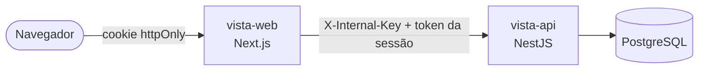

<div align="center">

# Vista

**Finanças pessoais sem planilha.**
Contas, cartões com fatura e parcelas, orçamento, metas e fluxo de caixa num só lugar, com cada pessoa vendo só os próprios dados.


[Funcionalidades](#funcionalidades) · [Arquitetura](#arquitetura) · [Rodando](#rodando) · [Segurança](#segurança) · [Status](#status)

</div>

---

## Funcionalidades

| | |
| --- | --- |
| **Visão geral** | Alertas, faturas abertas, orçamento do mês, metas e fluxo de caixa dos próximos meses. |
| **Lançamentos** | Receitas, despesas, transferências e ajustes. Compras parceladas, inclusive as que já estavam em andamento, e gastos fixos que se repetem todo mês. Exportação `.xlsx` do mês. |
| **Busca** | Texto sem diferenciar maiúsculas nem acentos, período, tipo, categoria e conta/cartão, com totais do resultado e filtros na URL. |
| **Recategorizar em lote** | Marque vários lançamentos e troque a categoria de uma vez; numa parcela, muda a compra inteira. |
| **Cartões** | Fatura por mês com fechamento e vencimento: a compra entra no mês em que a fatura vence. Pagamento de fatura a partir de uma conta. |
| **Contas** | Saldo e extrato de cada conta, com o saldo após cada movimento. |
| **Orçamento** | Limite por categoria, com ajuste para meses específicos. |
| **Metas** | Ligadas a uma conta de reserva: mostram o progresso, quanto falta e quanto guardar por mês para chegar no prazo. |
| **Categorias** | Toda conta nova já nasce com uma lista enxuta de categorias de despesa e receita, que você edita à vontade. |
| **Celular** | Barra inferior com o botão **+** para lançar de qualquer tela, listas que viram cartões e formulários em tela cheia. |
| **Aparência** | Tema escuro com cor de acento à escolha, lembrada entre as visitas. |

## Arquitetura

Monorepo simples: uma pasta por projeto, cada um com seu próprio `package.json`, build e dependências.

| Projeto | Stack | Porta |
| --- | --- | --- |
| [`vista-web`](vista-web/) | Next.js 16 (App Router, Server Components, Server Actions), React 19, Tailwind 4, Recharts | 3001 |
| [`vista-api`](vista-api/) | NestJS 11, TypeORM, PostgreSQL, argon2 | 3000 |



O navegador **só fala com o `vista-web`**. O servidor do Next chama a API com uma chave interna (`INTERNAL_API_KEY`, a mesma nos dois `.env`) e com o token da sessão, guardado num cookie que o JavaScript da página não lê. A API escuta só em `127.0.0.1`, e quem chama sem a chave recebe 404 em qualquer rota.

Na API, cada módulo (`Auth`, `Finance`) separa `Domain/` (entidades e interfaces), `Infra/` (TypeORM, implementações) e `Controllers/`. Detalhes nos READMEs de cada projeto.

## Rodando

**Requisitos:** Node.js 22+ e um PostgreSQL com um banco `vista`.

1. Crie os arquivos de ambiente a partir dos exemplos, `vista-api/.env.example` e `vista-web/.env.local.example`. Gere a `INTERNAL_API_KEY` (a mesma nos dois) e o `INVITE_CODE` com:

   ```bash
   node -e "console.log(require('crypto').randomBytes(32).toString('base64url'))"
   ```

2. Suba a API:

   ```bash
   cd vista-api
   npm install
   npm run migration:run
   npm run start:dev
   ```

3. Em outro terminal, suba o web:

   ```bash
   cd vista-web
   npm install
   npm run dev
   ```

4. Abra [localhost:3001/criar-conta](http://localhost:3001/criar-conta) e crie sua conta com o `INVITE_CODE`.

Esqueceu a senha? Não há envio de e-mail; gere uma temporária pelo terminal:

```bash
cd vista-api && npm run user:reset-password -- voce@exemplo.com
```

## Segurança

- **Dados isolados por usuário.** Todo dado financeiro tem dono, e toda consulta da API filtra por ele: o id de outra pessoa responde como inexistente.
- **API fechada.** Exige a chave interna antes de qualquer rota e escuta só em `127.0.0.1`.
- **Senhas e sessões.** Senhas com argon2id. Sessão de 30 dias, que acaba antes com 7 dias sem uso; trocar a senha encerra as outras sessões.
- **Contra força bruta.** Limite de tentativas de senha por e-mail e por IP, e de código de convite por IP e no total. O login não revela quais e-mails têm conta.
- **Cadastro fechado.** Só com código de convite.
- **Navegador.** CSP com nonce por requisição, cookie `httpOnly` (e `Secure` em produção) e os cabeçalhos de segurança usuais.

**Limites conhecidos:** por enquanto o app roda localmente, sem HTTPS. Para hospedar, é preciso HTTPS e um proxy que sobrescreva o `X-Forwarded-For`. O limite de tentativas fica em memória: zera quando a API reinicia e pede uma única instância.

## Status

- [x] Finanças: visão geral, lançamentos, cartões, contas, orçamento e metas
- [x] Contas de usuário com convite, e-mail e senha
- [x] Layout para celular
- [x] Busca entre meses e recategorização em lote
- [x] Categorias padrão
- [ ] Hospedagem com HTTPS e backup automático
- [ ] Login com Google
- [ ] Importar extrato (OFX/CSV)
- [ ] Assistente com IA

## Testes

A API tem testes unitários (Jest) de domínio, serviços e consultas, com tudo mockado:

```bash
cd vista-api && npm test
```
